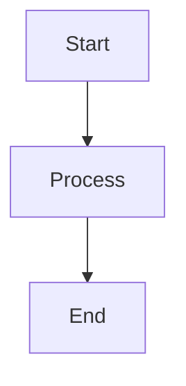
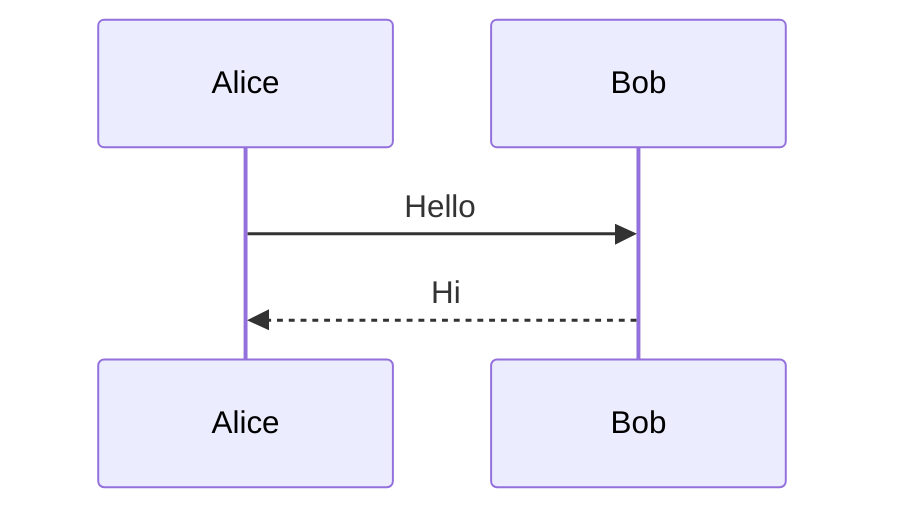

# Pele live-preview: ручной сценарий проверки (Фаза 2)

Цель: убедиться, что диаграммы Pele стабильны при наборе, смене темы и скролле.

## Подготовка

1. Собрать Debug: `xcodebuild -workspace "MacDown 3000.xcworkspace" -scheme MacDown -configuration Debug -destination 'platform=macOS,arch=arm64' CODE_SIGNING_ALLOWED=NO build`
2. Открыть собранный `MacDown 3000.app`, создать новый документ, вставить:

````markdown
# Pele check





```mermaid
not a diagram {{{
```
````

3. В Preferences → General → HTML → Mermaid должен быть включён.

## Шаги

1. **Первичный рендер.** Обе диаграммы видны как SVG; третий блок — красный `Pele Error` с текстом исходника. Ожидание: рендер < 1 с после открытия.
2. **Набор внутри диаграммы.** Поставить каретку в `B[Process]`, печатать/стирать по символу. Ожидание: нет мерцания (диаграмма не пропадает целиком), скролл preview не сбрасывается в начало, опечатанный промежуточный текст даёт error-блок, а не пустое место.
3. **Смена темы.** Preferences → Styles: выбрать `Github2 (dark).css`, затем обратно `GitHub2.css`. Ожидание: цвета диаграмм переключаются светлые/тёмные вместе со стилем (фон диаграммы совпадает с фоном preview), без перезагрузки документа.
4. **Скролл (регрессия).** Добавить под диаграммами 50 пустых строк, проскроллить preview вверх-вниз. Ожидание: позиция скролла сохраняется при донаборе текста выше диаграмм (штатный механизм DOM replacement, проверяем отсутствие регрессии).
5. **Экспорт HTML.** File → Export → HTML, открыть файл в браузере. Ожидание: диаграммы на месте (инлайн-скрипты).

## Критерий прохождения

Все 5 шагов — как в «Ожидание». Любое мерцание, сброс скролла или пустой блок вместо error — провал, фиксировать номер шага.
